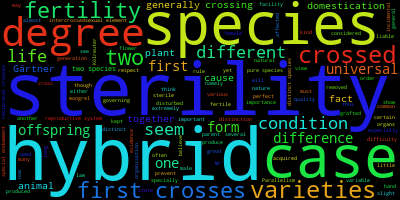

# Assignment 1
## 1.
#### A. DONE ON BASH
    cd IntroCompBio-2026/ #cd moves me into the directory that holds the files I need to pull from the remote GitHub
    git pull #this pulls the files from the remote GitHub into my folders so I can access the required files

#### B. DONE ON BASH
     grep 8 Gesquiere2011_data.csv #grep finds data within a dataset based on the number or letter listed next to it
                                   #but the 8 is showing every single 8 that exists in the whole dataset
     grep -w "8"  Gesquiere2011_data.csv #added the -w so that it only found 8's by themself with the addition of the "" doing the same thing
                                         #noticed from running this that the other 8's in the code are still pulling and being part of the answer
     grep -w -c "8"  Gesquiere2011_data.csv #didn't fixed the 8 problem yet but added the counting code to count the number of 8's
       78
     grep -w -c "^8"  Gesquiere2011_data.csv #did some research and found that ^ makes the code look at just the 8's at the beginning which are the sample numbers
       17
     grep -w -c "^22"  Gesquiere2011_data.csv #repeat pervious code but look at 22 instead of 8
       5
#### C. DONE ON BASH
###### Script Written:
    #defined the two arguements that will be used to run the script 
    #file will be arguement 1 and will tell the computer what file to read
    #id will be arguement 2 and will tell the computer to look for this specfic id/number
    file=$1
    id=$2

    #read this file and find this id number
    #this code just shows all the data and shows every single thing with the number
    #grep "$id" "$file"

    #-w this ensure that it just counts the number with no decimals and things like that
    #-c counts the amount of times that the number appears
    #grep -w -c "$id" "$file"
    #still giving me to many counts of the number

    #added the ^ to say to only look for the number at the beginning of the line
    grep -w -c "^$id" "$file"

###### Script Ran:
     #bash signals to read the script and run it, the script them follows, joined by the file name and the number that is trying to be found
     bash countsamples1C.txt Gesquiere2011_data.csv 8
        17
     bash countsamples1C.txt Gesquiere2011_data.csv 22
        5
#### D. DONE ON BASH
###### Script Written:
    #tr says to take whatever the separator is in this case a space and change it to a comma
    #input this into the file represented by $1 and then output the file Num_samples.csv

    cut -f1 "$1" | sort -n | uniq -c | awk '{print $2 "\t" $1}' | tr "\t" "," > "Num_samples.csv"
   
    #cut -f1 "$1" pulls all the information from field 1 
    #sort -n sorts all the information in field 1 numerically
    #uniq -c counts how often each seperate time each id appears
    #awk flips the column to format it to print the id and then the number of times in appears
    #tr "\t" "," I thought changed the file from tabs to separate to commas but it appears to put the two numbers in different sheet columns A and B
    #> says to output it as a file named num_samples.csv

    #the | uses what was just gathered and runs the next thing
###### Script Ran:
    bash changetocomma1D.txt Gesquiere2011_data.csv
    #Output was the file Num_samples.csv
## 2.
#### A. DONE ON BASH
    curl -o o.txt https://www.gutenberg.org/cache/epub/1228/pg1228.txt
    #the curl command downloads the link and then the -o names the link o.txt
#### B. DONE ON BASH
    #used grep --help to look at option of commands to "pair" with grep
    grep -i "sterility" o.txt | wc -w
        947
    grep -i "isolation" o.txt | wc -w
        112
    #grep find the thing asked for, -i says to ignore the different cases(upper and lower), then the word wanted is listed and the file name, wc -w says to count the number of times these words appear
#### C. DONE ON BASH
    grep -i "sterility" -B 3 -A 3 o.txt > sterility.txt
    grep -i "isolation" -B 3 -A 3 o.txt > isolation.txt
    #from the previous command used -B 3 and -A 3 was added to include the 3 lines before and the 3 lines after each word and then input it into the txt file
#### D. DONE ON JUPYTER
    conda install conda-forge::wordcloud
    #this is the code conda said to use to install the wordcloud
    !wordcloud_cli --text sterility.txt --imagefile sterility.png
    !wordcloud_cli --text isolation.txt --imagefile isolation.png
    #this is the way github said to write the code to make the wordcloud with the changes in the text to fit the right one, isolation or sterility
    #the ! tell jupyter to run it correctly
    Sterility Image
    

    Isolation Image
    
#### E. 
###### Based on my word clouds I think that Darwin did talk a little bit about speciation specifically sterility in hybrids and mentioning fertility a few times in the sterility word cloud. In the isolation word cloud the words natural selection and species were also mentioned but isolation in general was mentioned way less than sterility. Thus I believe that we definitely discussed pieces of the process but perhaps not the complete process as a whole. 
## 3.
#### DONE ON JUPYTER
###### Script Written:
    #!/usr/bin/env python3

    days = {1: "A Partridge in a Pear Tree", 2:"2 Turtle Doves", 3:"3 French Hens", 4:"4 Colly Birds", 5:"5 Gold Rings", 6:"Geese-a-Laying", 7: "Swans-a-Swimming", 8:"Maids-a-Milking", 9:"Ladies Dancing", 10:"Lords-a-Leaping", 11:"Pipers Piping", 12:"Drummers Drumming"}
    #made a dictionary relating each phrase with their day number and named in under days

    names = ["First", "Second", "Third", "Fourth", "Fifth", "Sixth", "Seventh", "Eighth", "Ninth", "Tenth", "Eleventh", "Twelfth"]
    #made a list of each day and named it names

    #for i in the dict from 1 to 12 used 13 because otherwise no 12
    #print the song with names included so first second etc.
    #used i-1 because it will match the number and the names correctly
    for i in range(1,13):
        print("On the", names[i-1], "day of Christmas my true love gave to me")
    
    for j in range(i, 0, -1):
        print(days[j])
    print("\n")
    
    #the i, 0 , -1 says to start at a number and count down to 0 without going past
    #print the dictionary for that number and counting down the rest
    #then in prints a new line and starts again
###### Script Ran:
    %run 12daysC.py
    #%run to run the python script 
        On the First day of Christmas my true love gave to me
        A Partridge in a Pear Tree

        On the Second day of Christmas my true love gave to me
        2 Turtle Doves
        A Partridge in a Pear Tree

        On the Third day of Christmas my true love gave to me
        3 French Hens
        2 Turtle Doves
        A Partridge in a Pear Tree

        On the Fourth day of Christmas my true love gave to me
        4 Colly Birds
        3 French Hens
        2 Turtle Doves
        A Partridge in a Pear Tree

        On the Fifth day of Christmas my true love gave to me
        5 Gold Rings
        4 Colly Birds
        3 French Hens
        2 Turtle Doves
        A Partridge in a Pear Tree

        On the Sixth day of Christmas my true love gave to me
        Geese-a-Laying
        5 Gold Rings
        4 Colly Birds
        3 French Hens
        2 Turtle Doves
        A Partridge in a Pear Tree

        On the Seventh day of Christmas my true love gave to me
        Swans-a-Swimming
        Geese-a-Laying
        5 Gold Rings
        4 Colly Birds
        3 French Hens
        2 Turtle Doves
        A Partridge in a Pear Tree

        On the Eighth day of Christmas my true love gave to me
        Maids-a-Milking
        Swans-a-Swimming
        Geese-a-Laying
        5 Gold Rings
        4 Colly Birds
        3 French Hens
        2 Turtle Doves
        A Partridge in a Pear Tree

        On the Ninth day of Christmas my true love gave to me
        Ladies Dancing
        Maids-a-Milking
        Swans-a-Swimming
        Geese-a-Laying
        5 Gold Rings
        4 Colly Birds
        3 French Hens
        2 Turtle Doves
        A Partridge in a Pear Tree

        On the Tenth day of Christmas my true love gave to me
        Lords-a-Leaping
        Ladies Dancing
        Maids-a-Milking
        Swans-a-Swimming
        Geese-a-Laying
        5 Gold Rings
        4 Colly Birds
        3 French Hens
        2 Turtle Doves
        A Partridge in a Pear Tree

        On the Eleventh day of Christmas my true love gave to me
        Pipers Piping
        Lords-a-Leaping
        Ladies Dancing
        Maids-a-Milking
        Swans-a-Swimming
        Geese-a-Laying
        5 Gold Rings
        4 Colly Birds
        3 French Hens
        2 Turtle Doves
        A Partridge in a Pear Tree

        On the Twelfth day of Christmas my true love gave to me
        Drummers Drumming
        Pipers Piping
        Lords-a-Leaping
        Ladies Dancing
        Maids-a-Milking
        Swans-a-Swimming
        Geese-a-Laying
        5 Gold Rings
        4 Colly Birds
        3 French Hens
        2 Turtle Doves
        A Partridge in a Pear Tree
