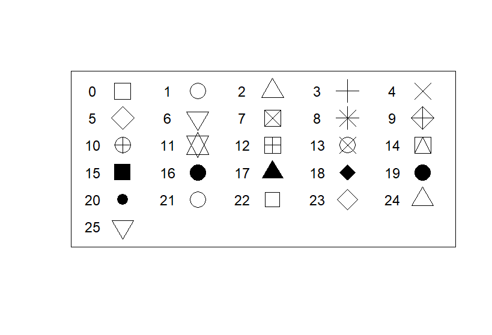
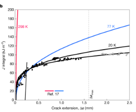
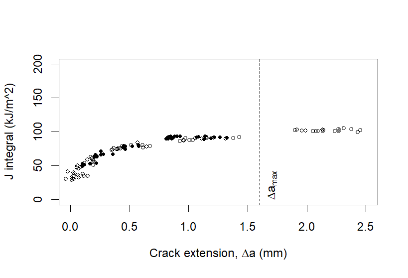

# Q1
###### Input:
    x <- rep(1:5, times=6)
    #repeat 1 through 5, 6 times
    y <- rep(6:1, each=5)
    #repeat 1 through 5, each number 5 times
    #both are named because in order to put it in a plot it 
    #needs to know what we're refering to

    plot(x, y, 
         pch = 0:30, cex = 2.5,
         yaxt = "n", xaxt = "n",
         ann = FALSE, xlim = c(0.5, 5.25),
         ylim = c(0.5, 6.5))
     
    x2 <- rep(seq(0.6, 4.6, 1), times = 6)
    #repeat the sequence of 0.6, 4.6, 1, 6 times and name it x2
    text(x2[1:26], y[1:26], 0:25)
    #x2 is the first one because it is the "first variation"
    #the second one is still y because it would be the "second variation" 
    #but it's still the same as the first code piece I wrote out
###### Output: 
Plot Symbol Image

# Q2
## Original
Plot Original Image

        I think it's a pretty good graph. I had a hard time finding a graph that also had a dataset to use to I am not fully
        aware about what it is about. But I think it compares the LH.S1 data points and the LH.S2 data points well with
        showing the two different lines that start together and then diverge, that I unfortunately was unable to replicate.
        I also like how there was the reference vertical line of the delta a max. 
        
        Citation: 
        Cook, D.H., Chen, X., O’Leary, M. et al. Competing mechanisms toughen bcc binary and medium-entropy alloys at 20 K. Nature 658, 923–929 (2026). https://doi.org/10.1038/s41586-026-11065-7

###### Input
        Figb <- read.csv("C:/Users/woodZ/IBC_2026_Wood/Practials/W11/DatasetOriginalJustFig1b.csv")

        plot(Figb$LH.S1, Figb$X)
        plot(Figb$LH.S2, Figb$X.2)

        #wanted to see where the points laid

        #?expression

        #Trying to start with one dataset and then build from there
        #named the x axis with expression so I could add in the Delta*a

        plot(Figb$LH.S1, Figb$X, xlab=expression(paste("Crack extension, ", Delta*a, " (mm)")), 
             ylab="J integral (kJ/m^2)", pch=20, cex=1, col="black",
             xlim=c(0,2.5), ylim=c(0,200))

        #adjusted the point size and shape and colored them black like in the original
        #adjusted the x and y limits because the original graph went up past 200 and past 2.5

        points(Figb$LH.S2, Figb$X.2, cex=0.75)

        #need to add second data set of points, can use function points for this
        #need to add lines can use line function but it needs to be an exponential line of best fit

        #lines(exp(Figb$LH.S1, Figb$X))
        #lines(Figb$LH.S2, Figb$X.2)
        #no work because just connect the points together

        #saved as chr not num need to opposite
        Figb$LH.S1 <- as.numeric(Figb$LH.S1)
        Figb$X <- as.numeric(Figb$X)
        Figb$LH.S2 <- as.numeric(Figb$LH.S2)
        Figb$X.2 <- as.numeric(Figb$X.2)

        #this means I can use lm to find the line of best fit but the line is not suppose to be a 
        #straight line, I can use log to add the curve
        lm(X ~ log(LH.S1), data=Figb)
        lm(X.2 ~ log(LH.S2), data=Figb)

        #not sure how to transition this into a curve on the graph, didn't go over this and having a hard time understanding 
        it by searching it up

        summary(Figb)

        #lines(Figb$LH.S1, Figb$X, col="black", lwd=2)
        #lines(Figb$LH.S2, Figb$X.2, col="black", lwd=2)
        #no work just connects the dots together

        #can't figure out how to make the red and blue line that don't have data attached to them

        #made the vertical line in the middle of the graph at 1.6, the lty=2 makes it dash
        abline(v=1.6, lty=2)
        text(1.7, 20,
             expression(Delta*a[max]),
             srt=90)

        #this puts a vertical test just to the right of the line with the positon 1.7 and veritcal position 20
        #the expression is the text that is written and the srt=90 rotates the line so it's vertical with the line

        #can't put the rest of the text because can create the lines

        ?abline
        ?exp
###### Output:
Plot Made Image

